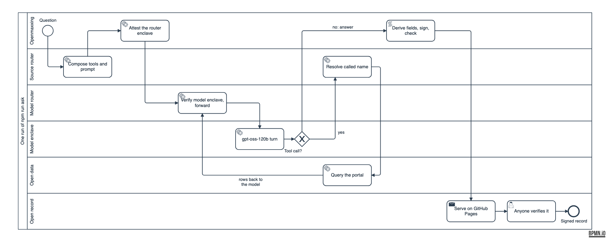

# Openmaxxing

One question goes in. An analysis of open data comes out as a signed record that anyone can check. Every layer between the question and the record is open: the code, the harness, both routers, the model's weights, the inference enclave, the data and the record format.

It is a worked example of [Civic AI Tools](https://github.com/npstorey/civic-ai-tools): one local command, a demo page, and a public record host on GitHub Pages.

**The recorded run:** "What were the five most common 311 complaint types in New York City in October 2026, and how many of each?" [Verify the signed record](https://typedstandards.org/verify?url=https%3A%2F%2Fopenmaxxing.typedstandards.org%2Fbundles%2Frun-20261107-192101.bundle.json) · [Watch it replay](https://openmaxxing.typedstandards.org/) · [`records/run-20261107-192101.signed.json`](records/run-20261107-192101.signed.json). **The same question, run and signed inside a Tinfoil Container:** [verify the enclave-signed record](https://typedstandards.org/verify?url=https%3A%2F%2Fopenmaxxing.typedstandards.org%2Fenclave%2Fbundles%2Frun-20261107-195452.bundle.json) ([below](#the-chain-inside-a-tinfoil-container)). An earlier record asks the same of Chicago's portal: [verify it](https://typedstandards.org/verify?url=https%3A%2F%2Fopenmaxxing.typedstandards.org%2Fbundles%2Frun-20261107-185729.bundle.json).

## The eight layers

| # | Layer | What runs | Open how |
|---|---|---|---|
| 1 | Open source software | This repository | [MIT](LICENSE) |
| 2 | Open harness | [`@typedstandards/civic-typed-harness`](https://www.npmjs.com/package/@typedstandards/civic-typed-harness) 0.11.0 records the run as a trace and derives the record's fields from it | MIT, [source](https://github.com/npstorey/civic-ai-tools/tree/main/packages/civic-typed-harness) |
| 3 | Open routers | The **source router**, [`@typedstandards/civic-typed-router`](https://www.npmjs.com/package/@typedstandards/civic-typed-router) 0.6.0, hands back the tools, the prompt and the dispatch map, and makes no calls itself. The **model router**, Tinfoil's [confidential model router](https://github.com/tinfoilsh/confidential-model-router), is `inference.tinfoil.sh`: it runs in its own enclave, verifies each model enclave, and forwards the request encrypted to that enclave's attested key | MIT; [open source](https://github.com/tinfoilsh/confidential-model-router) |
| 4 | Open-weight model | [`gpt-oss-120b`](https://huggingface.co/openai/gpt-oss-120b), named in every request and in the record | Apache-2.0 weights |
| 5 | Open inference | [Tinfoil](https://docs.tinfoil.sh/introduction.md): the model runs in a hardware enclave, and the [`tinfoil`](https://www.npmjs.com/package/tinfoil) SDK verifies the enclave by attestation before it sends anything | SDK Apache-2.0; Tinfoil states that all its security-critical code is open source |
| 6 | Open data | A Socrata portal, through [`socrata-mcp-server`](https://www.npmjs.com/package/socrata-mcp-server) 0.9.2 over stdio. Default portal: `https://data.cityofnewyork.us`, set in `openmaxxing.config.json` | MIT; the portal's own terms |
| 7 | Open record | A signed record served from this repository's GitHub Pages site, under its own `did:key` and key registry, checkable at [typedstandards.org/verify](https://typedstandards.org/verify) | Anyone can verify |
| 8 | Open standard | The [Typed Standards Specification v0.1](https://github.com/npstorey/civic-ai-tools/blob/main/docs/architecture/typed-standards-specification.md) | CC BY 4.0 |

Two notes on layer 5, in Tinfoil's words rather than this repository's. Tinfoil [states](https://docs.tinfoil.sh/introduction.md) that all its security-critical code is open source and that a client can verify the enclave runs the exact code published on GitHub. The SDK verifies the first enclave in the chain, the model router, and the router verifies each model enclave before forwarding ([Chaining enclaves](https://docs.tinfoil.sh/verification/verification-in-tinfoil.md)). This repository records what the SDK reported; it does not prove either statement.

## How a run flows



The diagram is [`docs/dataflow.bpmn`](docs/dataflow.bpmn), BPMN 2.0. The demo page renders it with bpmn-js and replays a recorded run on it step by step.

1. The source router composes the tools (`socrata__get_data`, `socrata__search`, `socrata__fetch`) and the system prompt, locked to one portal.
2. The Tinfoil SDK attests the model router's enclave. Nothing is sent until that passes.
3. The model router verifies the model enclave and forwards the request, encrypted.
4. When the model calls a tool, the source router resolves the called name (`resolveCalledName`) and `socrata-mcp-server` queries the portal. The rows go back to the model.
5. When the model answers, the harness derives the record's fields from the trace, and the Typed Standards CLI signs the record and checks it.
6. A push publishes it: the workflow builds, verifies and deploys the site. Anyone can verify the record.

## The chain inside a Tinfoil Container

The same chain also runs inside a [Tinfoil Container](https://docs.tinfoil.sh/containers/overview.md), and the enclave signs the record with a key it generated itself.

- **The code it runs.** [`src/enclave.mjs`](src/enclave.mjs), built from this repository's public source by [`build-image.yml`](.github/workflows/build-image.yml) into `ghcr.io/npstorey/openmaxxing@sha256:ac9a1dd0c451c5f5f1dc8318e70accb000af635da84511e72792f6b9ea1c5450`.
- **The measured config.** [`npstorey/openmaxxing-enclave`](https://github.com/npstorey/openmaxxing-enclave) pins that image by digest, release `v0.0.1`. Its source here is [`enclave/tinfoil-config.yml`](enclave/tinfoil-config.yml). Egress is an allowlist of three hosts: `atc.tinfoil.sh`, `inference.tinfoil.sh` and `data.cityofnewyork.us`.
- **The signing key.** `attested-keys: record-signing` (Ed25519) is generated inside the enclave on each deploy and never leaves it. Its public key is published in the enclave's attestation (`crypto_material`, format `https://tinfoil.sh/key/spki/v1`).
- **The client.** `op run --env-file=op.env -- npm run ask:enclave -- "<question>"` verifies the container's enclave with Tinfoil's SecureClient before it sends anything. It then calls `/ask` with a bearer token, so only the operator can spend the inference credits. It runs `tinfoil attestation verify -j` and checks that the record's signing key is the attested key: the recorded run printed `key binding: ok`.
- **The site, served from the enclave.** From release `v0.0.3`, a second instance serves the demo page itself at https://web.openmaxxing.containers.tinfoil.dev. A visitor's question runs inside the enclave and is signed by that instance's key. The record is then served from the enclave under `/live`, so typedstandards.org verifies it from there. Public questions are capped at 30 per instance and three per visitor every ten minutes. Records made there live in memory and are gone on restart.
- **Where the records live.** host-core 0.1.3 serves one key per registry, so records signed in the enclave have their own host at [`/enclave`](https://openmaxxing.typedstandards.org/enclave/records.json). Each run also serves the container's attestation (`container-attestation.json`) and the SecureClient's verification document (`container-verification.json`) beside the record, under [`docs/enclave/runs/`](docs/enclave/runs/).

## Prerequisites

- Node 22 or later, and npm.
- The [1Password CLI](https://developer.1password.com/docs/cli/), signed in (`op signin`). Credentials reach the process only through `op run --env-file`, which resolves `op://` references for one command. Nothing in this repository holds or prints a secret.
- A Tinfoil API key, from [tinfoil.sh](https://tinfoil.sh), stored in 1Password.
- A signing seed for your own `did:key`: 32 random bytes, made with `openssl rand -base64 32` and stored straight into 1Password. The seed is the only way to sign under your identifier, and a `did:key` cannot be rotated.
- Optional: a Socrata app token, for higher rate limits.

## From clone to verified record

```sh
git clone https://github.com/npstorey/openmaxxing && cd openmaxxing && npm ci
op run --env-file=op.env -- npm run ask -- "What were the five most common 311 complaint types in New York City in October 2026, and how many of each?"
npm run verify
```

Before the second command, copy [`op.env.example`](op.env.example) to `op.env` (gitignored) and point its references at your own 1Password items. The file holds `op://` references only.

`npm run ask` prints each step, the answer, the path of the signed record and its verify link. It writes:

| Path | What |
|---|---|
| `records/<run>.input.json` | The envelope input the harness derived |
| `records/<run>.signed.json` | The signed record, as the CLI printed it |
| `docs/runs/<run>/answer.md` | The answer, signed inline under `raw-bytes/v1` |
| `docs/runs/<run>/verification.json` | Tinfoil's verification document from `client.getVerificationDocument()` |
| `docs/runs/<run>/system-prompt.md` | The composed system prompt |
| `docs/runs/<run>/replay.json` | The run's steps and timing, for the demo page |

`npm run verify` runs what the publish workflow runs, offline: it builds the site into a temporary directory, verifies every record with the network blocked, and checks each served file against the SHA-256 its record signs.

To publish, set `origin` in `host.json` and `openmaxxing.config.json` to your Pages URL, turn on Pages with "GitHub Actions" as the source, then commit the run's files and push. [`publish.yml`](.github/workflows/publish.yml) builds, verifies and deploys; it holds no key and reads no secret.

### The demo page

Add `#demo` to the address, or press **Present**, to walk through the run one beat at a time: Next and Prev, or the arrow keys, Space and Page Up/Down, which is what a presentation clicker sends. Escape leaves.


```sh
npm run serve                                # replay only: no keys in the environment
op run --env-file=op.env -- npm run serve    # live mode on http://localhost:8787, with your keys
```

Public mode, on the Pages site, replays one real signed run step by step and holds no key. Live mode runs only when the page is served by `npm run serve` on your machine; the server listens on `127.0.0.1` only. Both end on the record's verify link. Beside the diagram, Tinfoil's [Verification Center](https://docs.tinfoil.sh/guides/verification-center.md) can show the verification document: in public mode that is the recorded run's document, not a live check.

## What this record proves / what it does not

**Attested**: checkable by anyone from the signed bundle, or from a served file against the hash the record signs.
**Asserted**: stated inside the signed bytes, resting on the producer's word.
**Tinfoil's statement**: checked by Tinfoil's SDK at run time, under Tinfoil's documented design; this repository records the result.
**Not covered**: nothing here addresses it.

| Property | Status | Why |
|---|---|---|
| The answer's bytes | Attested (#3, #4, #1) | The record carries `answer.md` inline under `raw-bytes/v1`. `shasum -a 256 docs/runs/<run>/answer.md` equals the record's `contentHash.sha256`. |
| The signature, and that the identifier is the key's | Attested (#2, #14, #6) | Ed25519 over the envelope hash; the `did:key` is derived from the key that signed. |
| The key is active | Host's statement (#5) | This site's `.well-known/typed-publisher.json` lists the key. That shows who publishes the statement, not who holds the key. |
| Who holds the key | Not covered | A pseudonymous `did:key` whose display name is `openmaxxing`. The only link to the author is this repository. |
| The question, each tool call, its arguments and timing | Asserted | In the signed trace and `queries[]`: tamper-evident, recorded by the producer. |
| The rows the model saw | Asserted | Each call's response SHA-256 is signed (`tool.response_hash`); the rows themselves are not stored. A portal's data changes, so a rerun can return other rows. |
| The composed system prompt | Attested, by hash | `skillMetadata.systemPromptHash` is signed and `docs/runs/<run>/system-prompt.md` is served; `shasum -a 256` of the file equals it. `npm run verify` checks it. |
| Tinfoil's verification document | Attested as captured | Its SHA-256, size and URL are signed in the record's `extensions` and the file is served. `npm run verify` or `shasum -a 256` checks it. The verifier at typedstandards.org does not fetch it: check #9 scans only `output`, `trace` and `skillMetadata.skillText`. |
| The model router's enclave ran its published code | Tinfoil's statement, at run time | The SDK checked the AMD SEV-SNP attestation, the Sigstore-signed release of `tinfoilsh/confidential-model-router` and their measurements before sending anything; the document reads `securityVerified: true` with all five steps passed. A later reader cannot rerun that check: Tinfoil keeps the evidence in transparency logs but "does not provide a supported tool for querying these records and reconstructing the verification" ([In-band vs. out-of-band verification](https://docs.tinfoil.sh/verification/verification-in-tinfoil.md)). The record shows that the producer captured this document at run time. |
| The model enclave ran `gpt-oss-120b` | Tinfoil's statement | The SDK verifies only the router. The router verifies each model enclave before forwarding, and the repository trusted for each model is compiled into the router's measured code (Tinfoil's [Chaining enclaves](https://docs.tinfoil.sh/verification/verification-in-tinfoil.md)). The verification document names the router, not the model enclave. |
| Freshness of the attestation | Not covered | The JavaScript verifier does not implement the freshness witness or revocation checks, and `verifiedAt` is the local clock, not an attested time ([JavaScript SDK](https://docs.tinfoil.sh/sdk/javascript-sdk.md)). The record names `releaseDigest`, so a reader can compare it with the release they expect. |
| The program that built the record, run locally | Asserted | The record names each package and version. Nothing attests the machine that ran `npm run ask`. |
| The enclave record was signed inside the container | Attested, against the attestation | The record's `signature.publicKey` is the `record-signing` key in the container's attestation. `container-attestation.json` is served beside the record, and its `crypto_material` entry holds the same SPKI bytes in hex. A new key is made on every deploy, so the binding names one deploy. The attestation file is the producer's capture; `tinfoil attestation verify` re-checks it while that deploy runs. |
| The container runs the published config and image | Tinfoil's statement, at run time | SecureClient and the Tinfoil CLI matched the enclave's measurement to release `v0.0.1` of `npstorey/openmaxxing-enclave`, which pins the image by digest. Whether that image is byte-for-byte what `build-image.yml` builds from this source is not checked; the build was not made reproducible. |
| The container's secrets | Not covered | The Tinfoil key, the Socrata token and the ask token are Tinfoil organization secrets. Tinfoil's [private secrets](https://docs.tinfoil.sh/containers/private-secrets.md), which Tinfoil never sees, need a keyserver and were not used. |
| Capture method and producer profile | Asserted (#15) | `chat-flow-stream` under `ai-assisted-analysis/openmaxxing-v1`: signed labels, checked by nothing. |
| When the record existed | Not covered | #7 does not apply: no RFC 3161 token was requested. `createdAt` is the signer's claim. |
| Inclusion in a transparency log | Not covered | #8 does not apply. |
| That the answer is correct | Not covered | A signature shows the bytes are unchanged since signing, not that they are true. |

## Next

- **The whole civicaitools.org website in a Tinfoil Container.** Its self-hosted stack is the app, Postgres, S3-style storage and a scheduler, so it needs a second container for the database and storage on the egress list.
- **A record bound to a fresh attestation.** With `attestation: true`, the container can request a fresh report whose nonce is the record's envelope hash. That would tie each record to the enclave at the moment of signing.
- **Private secrets.** Release the container's secrets from a keyserver the operator runs, so Tinfoil never sees them.

## Prior work

Openmaxxing depends on these published packages at exact versions. It forks and vendors none of them.

| Package | Version | What it does here | License |
|---|---|---|---|
| [`@typedstandards/civic-typed-router`](https://www.npmjs.com/package/@typedstandards/civic-typed-router) | 0.6.0 | The source router: tools, prompt, dispatch map, `resolveCalledName` | MIT |
| [`@typedstandards/civic-typed-harness`](https://www.npmjs.com/package/@typedstandards/civic-typed-harness) | 0.11.0 | `TraceBuilder`, data sources, the provenance graph, the record's derived fields | MIT |
| [`@typedstandards/cli`](https://www.npmjs.com/package/@typedstandards/cli) | 0.3.1 | Signs the envelope and checks it offline | MIT |
| [`@typedstandards/produce-core`](https://www.npmjs.com/package/@typedstandards/produce-core) | 0.9.1 | Envelope assembly, under the CLI and the harness | MIT |
| [`@typedstandards/host-core`](https://www.npmjs.com/package/@typedstandards/host-core) | 0.1.3 | Builds the served bundles, the key registry and the index; verifies them offline | MIT |
| [`socrata-mcp-server`](https://www.npmjs.com/package/socrata-mcp-server) | 0.9.2 | The open-data MCP server | MIT |
| [`tinfoil`](https://www.npmjs.com/package/tinfoil) | 1.4.0 | Tinfoil's JS SDK: `TinfoilAI`, attestation, `getVerificationDocument()` | Apache-2.0 |
| [`@modelcontextprotocol/sdk`](https://www.npmjs.com/package/@modelcontextprotocol/sdk) | 1.32.2 | The MCP client over stdio | MIT |
| [`bpmn-js`](https://bpmn.io/toolkit/bpmn-js/) | 18.31.0 | Renders the diagram on the demo page, from a pinned CDN build | bpmn.io license |

The publish workflow follows the Typed Standards [host template](https://github.com/npstorey/typedstandards-host-template)'s publish mode.

## Built today

Written on 2026-11-07:

- `src/chain.mjs`: the loop. Source router, Tinfoil, `resolveCalledName`, Socrata, with every step on a harness trace.
- `src/record.mjs`: the harness derives the fields; the CLI signs and checks; Tinfoil's verification document and the composed prompt are served beside the record and named by hash.
- `src/ask.mjs`, `src/verify.mjs`, `src/serve.mjs`: the three commands.
- `docs/dataflow.bpmn` and `docs/index.html`: the diagram and the demo page, with replay and live modes.
- `.github/workflows/publish.yml`, `host.json`, `host-policy.json`, `display.mjs`: this repository as its own record host.
- `src/enclave.mjs`, `Dockerfile`, `build-image.yml`, `enclave/`, `src/ask-enclave.mjs`: the chain in a Tinfoil Container, its config, and the client that verifies it and files its records.

## Layout

| Path | What |
|---|---|
| `openmaxxing.config.json` | Portal, model, origin, and this instance's own identity for the harness |
| `src/` | The chain, the record, the commands |
| `records/` | Envelope inputs and signed records |
| `docs/` | The demo page, the diagram, and each run's served files |
| `host.json`, `host-policy.json` | What the site serves, and its display policy |
| `op.env.example` | The `op://` references a run needs |

## License

MIT, © 2026 Nathan Storey.
